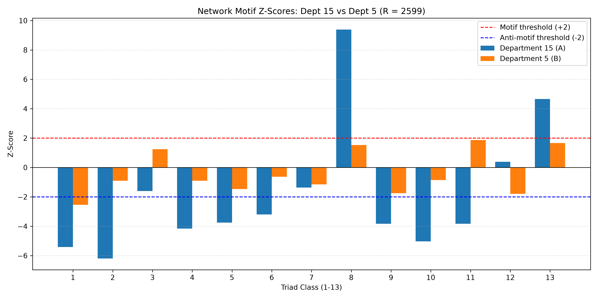

# CS1005 Discrete Structures — Fall 2026 Course Project
## Finding Network Motifs in an Email Network

### Group Members
* **Muhammad Abuzar** — `25i-0654` (Group Leader)
* **Ahmad Basit** — `25i-1047`
* **Noor Fatima** — `24i-0898`
* **Section:** B

---

### Group Parameters ($R = 2599$)
* **Group Number ($R$):** $654 + 1047 + 898 = 2599$
* **Pair Index:** $2599 \bmod 190 = 129 \rightarrow$ `top-20` indices `(8, 14)`
* **Department A:** Department `15` (`top-20[8]`) — **55 nodes, 357 edges** (2,142 swap attempts per network)
* **Department B:** Department `5` (`top-20[14]`) — **18 nodes, 147 edges** (882 swap attempts per network)
* **Number of Random Networks:** $20 + (2599 \bmod 31) = 46$
* **Swap Attempts per Random Network:** $(5 + (2599 \bmod 6)) \times \vert{}E\vert{} = 6 \times \vert{}E\vert{}$
* **Random Seed:** `2599`

---

### How to Run
1. Ensure both SNAP `email-Eu-core` dataset files are inside the `data/` directory:
   * `data/email-Eu-core.txt.gz`
   * `data/email-Eu-core-department-labels.txt.gz`
2. Install dependencies:
   ```bash
   pip install -r requirements.txt
   ```
3. Run the complete pipeline:
   ```bash
   python main.py
   ```
4. The script prints all derived parameters (T1/T2), real triad counts (T4), Z-scores (T6), motif/anti-motif summaries, and saves the grouped bar chart to `motif_zscores.png` (T7).

---

### T3: Hand-Worked Canonical Code Example
Consider the 3-node triad $T = \{a, b, c\}$ with directed edges $a \to b$, $a \to c$, and $b \to c$ (a feed-forward loop).

Using the fixed 6-bit encoding for an ordering $(x_0, x_1, x_2)$:
* **Bit 0 ($2^0 = 1$):** $x_0 \to x_1$
* **Bit 1 ($2^1 = 2$):** $x_0 \to x_2$
* **Bit 2 ($2^2 = 4$):** $x_1 \to x_0$
* **Bit 3 ($2^3 = 8$):** $x_1 \to x_2$
* **Bit 4 ($2^4 = 16$):** $x_2 \to x_0$
* **Bit 5 ($2^5 = 32$):** $x_2 \to x_1$

Evaluating all $3! = 6$ permutations of $(a, b, c)$:

| Ordering $(x_0, x_1, x_2)$ | Present Edges in Ordering | Active Bits | 6-bit Integer Code |
| :--- | :--- | :--- | :---: |
| $(a, b, c)$ | $0\to 1, 0\to 2, 1\to 2$ | Bits 0, 1, 3 ($1+2+8$) | **11** |
| $(a, c, b)$ | $0\to 1, 0\to 2, 2\to 1$ | Bits 0, 1, 5 ($1+2+32$) | 35 |
| $(b, a, c)$ | $0\to 2, 1\to 0, 1\to 2$ | Bits 1, 2, 3 ($2+4+8$) | 14 |
| $(b, c, a)$ | $0\to 1, 2\to 0, 2\to 1$ | Bits 0, 4, 5 ($1+16+32$) | 49 |
| $(c, a, b)$ | $1\to 0, 1\to 2, 2\to 0$ | Bits 2, 3, 4 ($4+8+16$) | 28 |
| $(c, b, a)$ | $1\to 0, 2\to 0, 2\to 1$ | Bits 2, 4, 5 ($4+16+32$) | 52 |

The minimum over all 6 permutations is **11**, which maps to **Class 5** in the sorted canonical table.

---

### T7 & T8: Results and Department Communication Comparison



Department 15 (55 nodes, 357 edges) and Department 5 (18 nodes, 147 edges) exhibit distinctly different communication structures relative to their degree-preserving null models. Department 15 shows strong, structured reciprocity: **Class 8** ($Z = 9.39$, two mutual/two-way relationships connected through a shared hub) and **Class 13** ($Z = 4.66$, fully reciprocal 3-person cliques where everyone emails everyone) appear as strong motifs, while purely one-way or unreciprocated structures—such as **Class 1** (one-way broadcast, $Z = -5.41$), **Class 2** (one-way chain, $Z = -6.19$), and Classes 4, 5, 6, 9, 10, and 11—are significantly underrepresented as anti-motifs. This indicates that communication in Department 15 relies heavily on two-way dialogue, collaborative sub-teams, and central coordinators rather than one-way announcements. In contrast, Department 5 is much smaller and denser, with **no statistically significant motifs** ($Z > 2$) and only one anti-motif (**Class 1**, $Z = -2.55$). While Department 5 also avoids purely one-way broadcasts, its high edge density means its overall triad distribution is largely explained by its degree sequence alone, resulting in a flatter, more uniformly interconnected communication pattern without the pronounced hub-and-clique clustering seen in Department 15.

---

### Contributions
* **Muhammad Abuzar (`25i-0654`):** Implemented T1 & T2 (`src/data_loader.py`), data cleaning, top-20 ranking, parameter derivation, induced subgraphs, and T6 Z-score pipeline (`main.py`).
* **Ahmed Basit (`25i-1047`):** Implemented T3 & T4 (`src/motifs.py`), 6-bit canonical triad classification, hand-worked example, and neighbor-pair triad census.
* **Noor Fatima (`24i-0898`):** Implemented T5 (`src/randomizer.py`) double-edge swap randomization with degree-preservation assertions, T7 (`src/plotting.py`) grouped bar chart, and T8 department comparison.